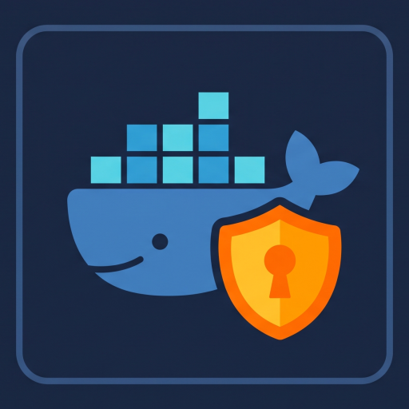

<p align="center">
  
</p>

<h1 align="center">MobyGuard</h1>

<p align="center">
  <b>Lightweight, self-hosted Docker and OCI Registry Control Plane.</b><br />
  Fine-grained repository access control, ECDSA token authentication, and management dashboard for Docker Distribution.
</p>

<p align="center">
  
  
  
  
  
  
</p>

---

## Why MobyGuard?

Organizations deploying private Docker registries typically face two limitations:

* **Docker Registry & CNCF Distribution (`registry:2` / `registry:3`) Limitations**:
  * Relies on basic `htpasswd` authentication, granting all-or-nothing access to all images.
  * Lacks repository-level authorization and cannot restrict user permissions by namespace.
  * Does not provide a web management interface for browsing tags, inspecting manifests, or deleting images.

* **Enterprise Registry Suites (e.g., Harbor) Overhead**:
  * Requires substantial server resources (6 to 8 containers, 4GB to 8GB+ RAM).
  * Involves complex deployment charts and operational maintenance overhead.

**MobyGuard provides a focused solution**: A lightweight, single-appliance control plane (~80MB RAM) that adds native Docker Registry v2 token authentication, fine-grained access control lists, and an administrative dashboard directly on top of vanilla Docker Distribution.

---

## Features

* **Docker v2 and OCI Token Authentication**:
  * Fully compliant with the [Docker Registry v2 Bearer Token Specification](https://distribution.github.io/distribution/spec/auth/token/).
  * Compatible with standard `docker login`, `docker pull`, and `docker push` workflows.
  * Asymmetric ECDSA P-256 (`ES256`) token signing with a public JWKS endpoint (`/api/Token/jwks`).

* **Repository Access Control (ACL)**:
  * Per-user policy scoping supporting exact matches (`team-a/backend`), namespace wildcards (`team-a/*`), or global access (`*`).
  * Granular action control with independent toggles for **Pull**, **Push**, and **Delete** capabilities.

* **Web Management Dashboard**:
  * Catalog exploration with RFC 5988 pagination supporting large-scale registries (10,000+ repositories).
  * OCI and Docker v2 manifest inspection, including media types, digest checksums, layer sizes, and container configurations.
  * Image tag deletion workflows directly from the interface.

* **User and Service Account Management**:
  * User account provisioning with role assignments (`Admin`, `User`).
  * Dedicated headless accounts (`Service`) designed for CI/CD automation pipelines (GitHub Actions, GitLab CI, Drone).

* **Security Architecture**:
  * High-iteration `PBKDF2-HMAC-SHA512` password hashing with unique per-user cryptographic salts.
  * 15-minute JWT lifetime with Redis-backed refresh token rotation and instant user-level revocation.
  * Rate-limiting and brute-force lockout protection via Redis.
  * Hardened frontend delivery with sourcemap generation disabled in production builds.

* **Audit Logging**:
  * Structured audit trail recording token issuances, image deletions, user creations, and policy changes.

---

## Architecture

```
                             ┌───────────────────────────────┐
                             │      Docker CLI / Kaniko      │
                             │  (docker push / docker pull)  │
                             └──────────┬─────────▲──────────┘
                                        │         │
                     1. Basic Auth      │         │ 2. Issue Signed JWT
                     GET /api/Token     │         │    (Bearer Token)
                                        ▼         │
                     ┌────────────────────────────┴──┐
                     │    Reverse Proxy / Gateway    │
                     └───────┬───────────────┬───────┘
                             │               │
            /api/* (Control) │               │ 3. Stream Layers /v2/*
                             ▼               ▼    (Bearer Token Auth)
                   ┌───────────────────┐   ┌───────────────────┐
                   │     MobyGuard     │   │  Docker Registry  │
                   │  (Auth & Web UI)  │   │ (registry:2 / v3) │
                   └─┬───────────────┬─┘   └─────────┬─────────┘
                     │               │               │
                     ▼               ▼               ▼
               ┌───────────┐   ┌───────────┐   ┌───────────┐
               │PostgreSQL │   │   Redis   │   │  Storage  │
               │(Database) │   │  (Cache)  │   │  Volume   │
               └───────────┘   └───────────┘   └───────────┘
```

* **Step 1 (Token Request)**: The Docker client requests an access token from MobyGuard (`/api/Token`) using HTTP Basic authentication.
* **Step 2 (Token Issuance)**: MobyGuard evaluates the user's repository permissions in PostgreSQL and returns a cryptographically signed ECDSA `ES256` Bearer JWT.
* **Step 3 (Layer Streaming)**: The Docker client presents the Bearer token directly to Docker Registry (`/v2/`), which verifies the signature and streams image layer blobs directly to storage.
* **Control Plane Isolation**: MobyGuard handles authentication, authorization policy evaluation, user management, and dashboard operations without bottlenecking image layer transfers.

---

## Quick Start

Deploy MobyGuard with Docker Compose without needing to clone the source repository.

### 1. Create Working Directory and Generate Certificates
Create a project folder and generate the ECDSA P-256 (`ES256`) keypair used by MobyGuard to sign Registry JWTs and by Docker Registry to verify them:

```bash
mkdir -p mobyguard/certs && cd mobyguard

openssl req -x509 -newkey ec -pkeyopt ec_paramgen_curve:prime256v1 -sha256 -nodes \
  -keyout certs/registry-auth.key \
  -out certs/registry-auth.crt \
  -days 3650 \
  -subj "/CN=mobyguard-token-issuer"
chmod 644 certs/*
```

### 2. Configure `compose.yml`
Save the following configuration as `compose.yml` (or download it via `curl -O https://raw.githubusercontent.com/sbairamis/mobyguard/main/compose.yml`):

```yaml
services:
  mobyguard:
    image: ghcr.io/sbairamis/mobyguard:${API_VERSION:-latest}
    restart: unless-stopped
    container_name: mobyguard
    ports:
      - "${API_PORT:-5090}:5090"
    volumes:
      - ${CERTS_DIR:-./certs}:/app/certs:ro
    depends_on:
      postgres:
        condition: service_healthy
      redis:
        condition: service_healthy
    environment:
      # Database & Redis Connections
      - ConnectionStrings__DefaultConnection=${POSTGRES_CONN_STRING:-Host=postgres;Port=5432;Database=${DB_NAME:-mobyguard};Username=${DB_USER:-mobyguard};Password=${DB_USER_PASS};}
      - ConnectionStrings__RedisConnection=${REDIS_CONN_STRING:-redis:6379,password=${REDIS_PASS}}

      # Upstream Registry & Token Signing
      - RegistryTokenOptions__RegistryUrl=${REGISTRY_URL:-http://registry:5000}
      - RegistryTokenOptions__Issuer=${REGISTRY_TOKEN_ISSUER:-mobyguard-token-issuer}
      - RegistryTokenOptions__Service=${REGISTRY_TOKEN_SERVICE:-registry}
      - RegistryTokenOptions__CertificatePath=${REGISTRY_CERT_PATH:-/app/certs/registry-auth.crt}
      - RegistryTokenOptions__PrivateKeyPath=${REGISTRY_KEY_PATH:-/app/certs/registry-auth.key}
      - RegistryTokenOptions__TokenExpiryMinutes=${REGISTRY_TOKEN_EXPIRY_MIN:-15}

      # Web Auth & JWT
      - JwtOptions__Issuer=${JWT_ISSUER:-mobyguard}
      - JwtOptions__Audience=${JWT_AUDIENCE:-mobyguard}
      - JwtOptions__SecurityKey=${JWT_SECURITY_KEY}
      - JwtOptions__AccessTokenExpiryMinutes=${ACCESS_TOKEN_EXPIRY_MIN:-15}
      - JwtOptions__RefreshTokenExpiryDays=${REFRESH_TOKEN_EXPIRY_DAYS:-7}

      # Hosting
      - HostingOptions__Scheme=${HOSTING_SCHEME:-http}
      - HostingOptions__Ip=${HOSTING_IP:-0.0.0.0}
      - HostingOptions__Port=${API_PORT:-5090}
    healthcheck:
      test: ["CMD", "curl", "-f", "http://localhost:5090/api/health"]
      interval: 10s
      timeout: 5s
      retries: 5
      start_period: 10s
    networks:
      - default
      - registry-net

  postgres:
    image: postgres:17-alpine
    restart: unless-stopped
    container_name: mobyguard-postgres
    ports:
      - "${DB_PORT:-127.0.0.1:5432}:5432"
    environment:
      POSTGRES_USER: ${DB_USER:-mobyguard}
      POSTGRES_PASSWORD: ${DB_USER_PASS}
      POSTGRES_DB: ${DB_NAME:-mobyguard}
    volumes:
      - ./data/postgres:/var/lib/postgresql/data
    healthcheck:
      test: ["CMD-SHELL", "pg_isready -U ${DB_USER:-mobyguard} -d ${DB_NAME:-mobyguard}"]
      interval: 10s
      timeout: 5s
      retries: 5

  redis:
    image: redis:8.10-alpine
    container_name: mobyguard-redis
    restart: unless-stopped
    volumes:
      - ./data/redis:/data
    environment:
      - REDISCLI_AUTH=${REDIS_PASS}
    command: >
      redis-server
      --requirepass ${REDIS_PASS}
      --appendonly yes
    healthcheck:
      test: ["CMD", "redis-cli", "ping"]
      interval: 10s
      timeout: 5s
      retries: 5
      start_period: 5s

networks:
  registry-net:
    external: true
```

### 3. Configure Environment Variables
Create a `.env` file in the same directory (or download it via `curl -O https://raw.githubusercontent.com/sbairamis/mobyguard/main/.env.example && cp .env.example .env`):

```bash
cat << 'EOF' > .env
# Database Credentials
DB_USER_PASS=change_this_postgres_password

# Redis Credentials
REDIS_PASS=change_this_redis_password

# Web UI Authentication (minimum 32 characters)
JWT_SECURITY_KEY=generate_a_secure_random_32_character_security_key_here!

# Upstream Docker Registry / CNCF Distribution URL
REGISTRY_URL=http://registry:5000
EOF
```

* **`JWT_SECURITY_KEY`**: Set a cryptographically secure random string with at least 32 characters (e.g., generated with `openssl rand -base64 32`).
* **`REGISTRY_URL`**: Set the URL of your Docker Registry or CNCF Distribution instance.

### 4. Deploy the Services
Ensure the shared Docker bridge network exists and start the containers:

```bash
docker network create registry-net 2>/dev/null || true
docker compose up -d
```

### 5. Initialize the Administrator Account
* Navigate to `http://localhost:5090` in your web browser.
* Complete the initial administrator setup form.

---

## Docker CLI Usage

### Authentication
```bash
docker login localhost:5090
```

### Push Workflow
```bash
docker tag my-app:latest localhost:5090/team-a/my-app:1.0.0
docker push localhost:5090/team-a/my-app:1.0.0
```

### Pull Workflow
```bash
docker pull localhost:5090/team-a/my-app:1.0.0
```

* **CI/CD Pipelines**: Provision an account with the `Service` role in the dashboard, grant appropriate repository permissions, and store the credentials in pipeline secrets (`DOCKER_USERNAME`, `DOCKER_PASSWORD`).

---

## Tech Stack

* **Backend**: [.NET 10 (C#)](https://dotnet.microsoft.com/) — ASP.NET Core Web API with Microsoft OpenAPI.
* **Frontend**: [React 19](https://react.dev/) + [Vite](https://vitejs.dev/) embedded in `wwwroot`.
* **Database**: [PostgreSQL 17](https://www.postgresql.org/) for relational persistence and policy storage.
* **Cache**: [Redis 8](https://redis.io/) for JWT revocation, sessions, and rate-limiting.
* **Token Signer**: Cryptographic ECDSA `ES256` token signing.
* **Testing**: Integration testing with xUnit v3 and **Testcontainers**.

---

## License

This project is licensed under the [MIT License](LICENSE).
