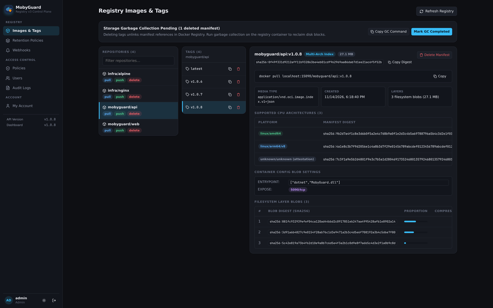
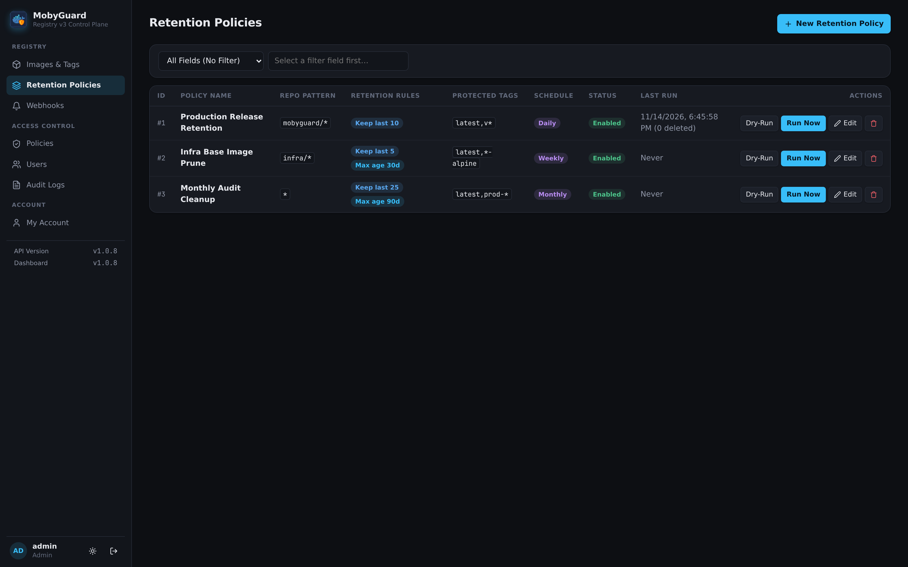
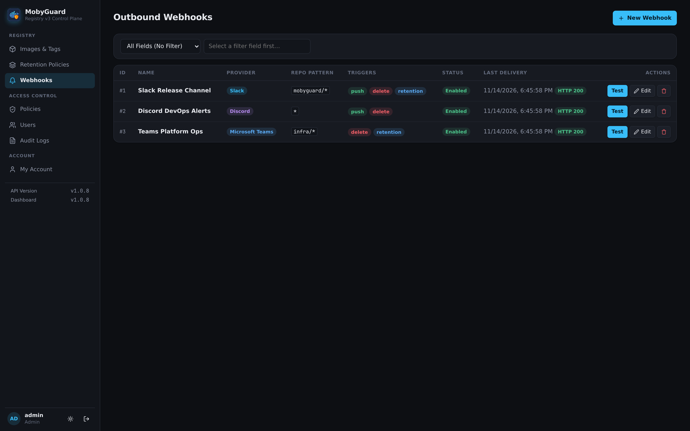
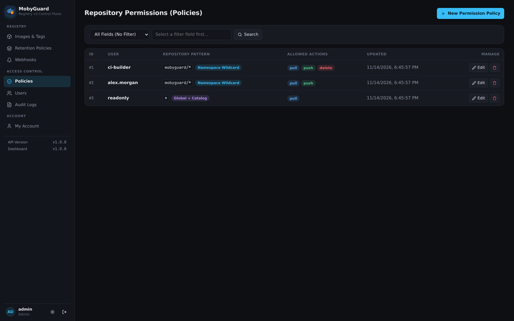
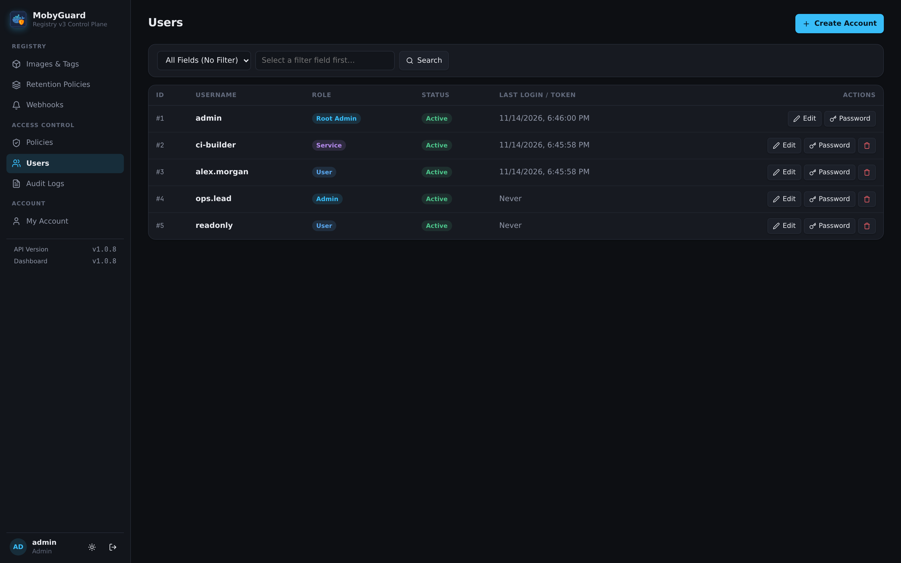
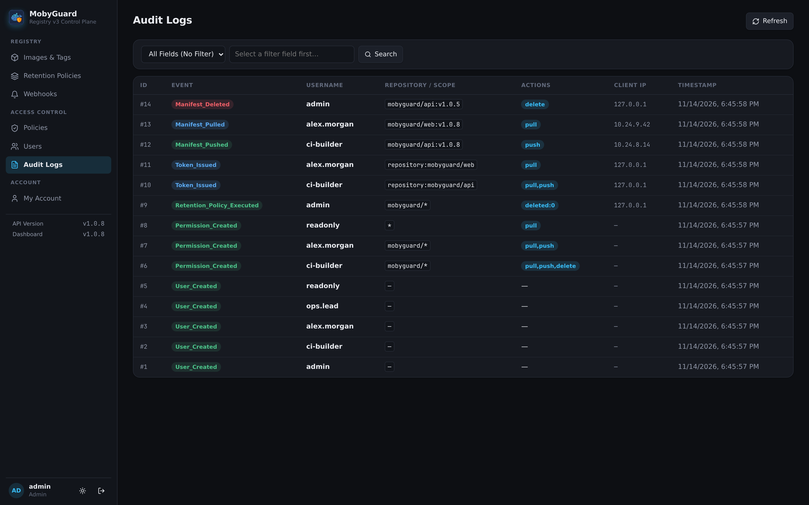
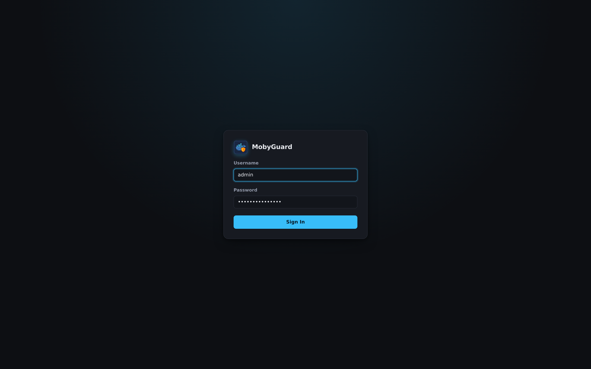

<p align="center">
  
</p>

<h1 align="center">MobyGuard</h1>

<p align="center">
  <b>Lightweight, self-hosted Docker and OCI Registry Control Plane.</b><br />
  Fine-grained repository access control, ECDSA token authentication, automated tag retention, Slack/Discord/Teams notifications, and management dashboard for Docker Distribution.
</p>

<p align="center">
  
  
  
  
  
  
</p>

<p align="center">
  
</p>

---

## Why MobyGuard?

Organizations deploying private Docker registries typically face two limitations:

* **Docker Registry & CNCF Distribution (`registry:2` / `registry:3`) Limitations**:
  * Relies on basic `htpasswd` authentication, granting all-or-nothing access to all images.
  * Lacks repository-level authorization and cannot restrict user permissions by namespace.
  * Does not provide a web management interface, automated tag cleanup policies, or webhook notifications.

* **Enterprise Registry Suites (e.g., Harbor) Overhead**:
  * Requires substantial server resources (6 to 8 containers, 4GB to 8GB+ RAM).
  * Involves complex deployment charts and operational maintenance overhead.

**MobyGuard provides a focused solution**: A lightweight, single-appliance control plane (~80MB RAM) that adds native Docker Registry v2 token authentication, fine-grained access control lists, scheduled tag retention, multi-platform notifications, and an administrative dashboard directly on top of vanilla Docker Distribution.

---

## Features

* **Docker v2 and OCI Token Authentication**:
  * Fully compliant with the [Docker Registry v2 Bearer Token Specification](https://distribution.github.io/distribution/spec/auth/token/).
  * Compatible with standard `docker login`, `docker pull`, and `docker push` workflows.
  * Asymmetric ECDSA P-256 (`ES256`) token signing with a public JWKS endpoint (`/api/v1/Token/jwks`).

* **Repository Access Control (ACL)**:
  * Per-user policy scoping supporting exact matches (`team-a/backend`), namespace wildcards (`team-a/*`), or global access (`*`).
  * Granular action control with independent toggles for **Pull**, **Push**, and **Delete** capabilities.

* **Multi-Arch Web Management Dashboard & GC Tracking**:
  * Single-flight catalog discovery with 15-second caching, RFC 5988 pagination, live search, and force refresh.
  * OCI & Docker v2 manifest inspection with multi-architecture index platform switching (`linux/amd64`, `linux/arm64`, etc.), Buildx attestation classification, container configuration details, and layer breakdown.
  * Pending Garbage Collection tracking banner with one-click copyable CLI cleanup command and admin GC acknowledgment.

* **Automated Tag & Repository Retention Policies**:
  * Pattern-scoped policies (`*`, `namespace/*`, exact repo) with configurable `Keep Last N` counts, `Max Age (Days)` thresholds, and comma-separated protected tag globs (e.g., `latest,v*,prod-*`).
  * **Shared-Digest Safety**: Refuses to delete any manifest digest still referenced by a kept or protected tag.
  * Interactive **Dry Run** previews plus a background scheduler supporting **Manual Only**, **Hourly**, **Daily**, **Weekly**, and **Monthly** intervals.

* **Inbound Registry Events & Outbound Webhooks**:
  * **Inbound Registry Webhook Receiver** (`POST /api/v1/Registry/events`): Ingests Docker Distribution notifications with optional constant-time `WebhookSecret` verification, records CLI `push` / `pull` / `delete` events with client IPs, and invalidates cached catalog/tags.
  * **Outbound Webhook Notifications**: Delivers formatted notifications for **Slack** (Block Kit), **Discord** (rich embeds), and **Microsoft Teams** (Workflows Adaptive Cards) filtered by repository pattern and trigger (`Push`, `Delete`, `Retention`), with built-in test delivery status tracking.

* **User, Service Account & Root Admin Governance**:
  * Dedicated human (`Admin`, `User`) and headless CI/CD (`Service`) accounts, with bootstrap **Root Admin (`Id == 1`) protection** blocking deletion, demotion, deactivation, or modification by secondary admins.
  * High-iteration `PBKDF2-HMAC-SHA512` password hashing, strict password complexity + common/username blacklist enforcement, 15-minute JWTs with single-use hashed refresh token rotation, and IP brute-force lockouts.
  * Unified dropdown filter bars across Users, Policies, Retention Policies, Webhooks, and Audit Logs, plus light/dark themes.

* **Audit Logging**:
  * Searchable audit trail recording token issuances, manifest pushes/pulls/deletes, user & policy mutations, retention executions, and GC acknowledgments.

---

## Screenshots

### Images & Manifest Inspector
Browse catalog repositories, inspect multi-arch OCI and Docker v2 manifests, examine layers and container config settings, and track pending garbage collection:

<p align="center">
  
</p>

### Retention Policies & Scheduler
Configure namespace-scoped tag cleanup rules, protect release tags, preview changes with Dry Run, and automate runs Hourly, Daily, Weekly, or Monthly:

<p align="center">
  
</p>

### Outbound Webhooks (Slack, Discord & Microsoft Teams)
Route repository `push`, `delete`, and `retention` notifications to Slack, Discord, or Microsoft Teams with live delivery testing:

<p align="center">
  
</p>

### Access Control Policies
Manage per-user repository authorization rules with exact or wildcard (`namespace/*`) patterns, dropdown filtering, and granular Pull, Push, and Delete toggles:

<p align="center">
  
</p>

### User & Service Account Management
Provision human operator accounts with Root Admin protection and dedicated headless service accounts for CI/CD automation pipelines:

<p align="center">
  
</p>

### Audit Trail
Monitor token issuances, CLI image pushes/pulls/deletes, retention runs, and administrative actions with client IP addresses and timestamps:

<p align="center">
  
</p>

### Authentication Interface
Clean sign-in interface with ECDSA token authentication and initial admin onboarding:

<p align="center">
  
</p>

---

## Architecture

```
                             ┌───────────────────────────────┐
                             │      Docker CLI / Kaniko      │
                             │  (docker push / docker pull)  │
                             └──────────┬─────────▲──────────┘
                                        │         │
                     1. Basic Auth      │         │ 2. Issue Signed JWT
                     GET /api/v1/Token  │         │    (Bearer Token)
                                        ▼         │
                     ┌────────────────────────────┴──┐
                     │    Reverse Proxy / Gateway    │
                     └───────┬───────────────┬───────┘
                             │               │
            /api/* (Control) │               │ 3. Stream Layers /v2/*
                             ▼               ▼    (Bearer Token Auth)
                   ┌───────────────────┐   ┌───────────────────┐
                   │     MobyGuard     │◄──┤  Docker Registry  │
                   │  (Auth & Web UI)  │   │ (registry:2 / v3) │
                   └────┬─────────┬────┘   └─────────┬─────────┘
                        │         │ (Events /v1)     │
                        │         ▼                  ▼
                        │   ┌───────────┐      ┌───────────┐
                        │   │  Slack /  │      │  Storage  │
                        │   │  Discord  │      │  Volume   │
                        │   │  / Teams  │      └───────────┘
                        │   └───────────┘
                        ▼
                  ┌───────────┐
                  │  SQLite   │
                  │(Database) │
                  └───────────┘
```

* **Step 1 (Token Request)**: The Docker client requests an access token from MobyGuard (`/api/v1/Token`) using HTTP Basic authentication.
* **Step 2 (Token Issuance)**: MobyGuard evaluates the user's repository permissions in SQLite and returns a cryptographically signed ECDSA `ES256` Bearer JWT.
* **Step 3 (Layer Streaming & Notifications)**: The Docker client presents the Bearer token directly to Docker Registry (`/v2/`), which verifies the signature and streams image layer blobs directly to storage. Optional Distribution notifications forward push/pull/delete events to MobyGuard (`POST /api/v1/Registry/events`), triggering audit logs, cache invalidation, and Slack/Discord/Teams alerts.

---

## Quick Start

Deploy MobyGuard with Docker Compose without needing to clone the source repository.

### 1. Create Working Directory and Generate Certificates
Create a project folder and generate the ECDSA P-256 (`ES256`) keypair used for Docker Registry token authentication:

```bash
mkdir -p mobyguard/certs && cd mobyguard

openssl req -x509 -newkey ec -pkeyopt ec_paramgen_curve:prime256v1 -sha256 -nodes \
  -keyout certs/registry-auth.key \
  -out certs/registry-auth.crt \
  -days 3650 \
  -subj "/CN=mobyguard-token-issuer"
chmod 644 certs/*
```

#### Certificate Roles and Trust Relationship
* **Asymmetric ECDSA (`ES256`)**: MobyGuard implements the [Docker Registry v2 Bearer Token Specification](https://distribution.github.io/distribution/spec/auth/token/). Token generation uses elliptic curve cryptography (`prime256v1`), delivering the security strength of 3072-bit RSA with smaller token payload sizes and faster verification.
* **`certs/registry-auth.key` (Private Key)**:
  * Kept strictly confidential by MobyGuard.
  * Mounted into the MobyGuard container at `/app/certs/registry-auth.key`.
  * Used exclusively by MobyGuard's `/api/v1/Token` endpoint to sign outgoing Bearer JWTs granted to Docker CLI clients.
* **`certs/registry-auth.crt` (Public Certificate)**:
  * Contains the public key and issuer identity (`CN=mobyguard-token-issuer`).
  * Mounted into both MobyGuard and the Docker Registry container.
  * Docker Registry uses this certificate as its root trust bundle to verify the signature of incoming Bearer tokens without requiring access to the private key.

#### Upstream Docker Registry Configuration
To configure Docker Registry (or CNCF Distribution) to authenticate via MobyGuard using this certificate, apply the following settings to your registry container:

```yaml
environment:
  REGISTRY_STORAGE_DELETE_ENABLED: "true"
  REGISTRY_AUTH: token
  REGISTRY_AUTH_TOKEN_REALM: https://registry.example.com/api/v1/Token
  REGISTRY_AUTH_TOKEN_SERVICE: registry
  REGISTRY_AUTH_TOKEN_ISSUER: mobyguard-token-issuer
  REGISTRY_AUTH_TOKEN_ROOTCERTBUNDLE: /certs/registry-auth.crt
volumes:
  - ./certs/registry-auth.crt:/certs/registry-auth.crt:ro
```

*(Optional — Recommended for real-time audit logs, cache invalidation, GC tracking, and Slack/Discord/Teams push alerts)*: Configure Docker Distribution's webhook notifications to forward events to MobyGuard:

```yaml
notifications:
  endpoints:
    - name: mobyguard
      url: http://mobyguard:5090/api/v1/Registry/events
      headers:
        X-Registry-Webhook-Secret:
          - your_shared_webhook_secret
      timeout: 2s
      threshold: 3
      backoff: 1s
```

### 2. Configure `compose.yml`
Save the following configuration as `compose.yml` *(when running behind a reverse proxy on the same host, prefer binding `127.0.0.1:${API_PORT:-5090}:5090` so external callers cannot bypass proxy headers)*:

```yaml
services:
  mobyguard:
    image: ghcr.io/sbairamis/mobyguard:${API_VERSION:-latest}
    restart: unless-stopped
    container_name: mobyguard
    ports:
      - "${API_PORT:-5090}:5090"
    volumes:
      - ${CERTS_DIR:-./certs}:/app/certs:ro
      - sqlite-data:/app/data
    environment:
      ConnectionStrings__DefaultConnection: ${SQLITE_CONN_STRING:-Data Source=/app/data/mobyguard.db}
      RegistryTokenOptions__RegistryUrl: ${REGISTRY_URL}
      RegistryTokenOptions__WebhookSecret: ${REGISTRY_WEBHOOK_SECRET:-}
      JwtOptions__SecurityKey: ${JWT_SECURITY_KEY}
    healthcheck:
      test: ["CMD", "curl", "-f", "http://localhost:5090/api/v1/health"]
      interval: 10s
      timeout: 5s
      retries: 5
      start_period: 10s
    networks:
      - default
      - registry-net

volumes:
  sqlite-data:

networks:
  registry-net:
    external: true
```

### 3. Configure Environment Variables
Create a `.env` file in the same directory (or copy from [`.env.example`](.env.example)):

```bash
cat << 'EOF' > .env
# Database Connection String (SQLite)
SQLITE_CONN_STRING=Data Source=/app/data/mobyguard.db

# Upstream Docker Registry / CNCF Distribution URL
REGISTRY_URL=http://registry:5000

# Optional shared secret for inbound Registry events (POST /api/v1/Registry/events)
REGISTRY_WEBHOOK_SECRET=

# Web UI Authentication (minimum 32 characters)
JWT_SECURITY_KEY=generate_a_secure_random_32_character_security_key_here!
EOF
```

* **`SQLITE_CONN_STRING`**: Connection string used by MobyGuard for its embedded SQLite database (stored in the `sqlite-data` volume at `/app/data/mobyguard.db`).
* **`REGISTRY_URL`**: URL of your Docker Registry or CNCF Distribution instance.
* **`REGISTRY_WEBHOOK_SECRET`**: Optional shared secret validated by `POST /api/v1/Registry/events` (`X-Registry-Webhook-Secret` header or `Authorization: Bearer`).
* **`JWT_SECURITY_KEY`**: Cryptographically secure random string with at least 32 characters (e.g., generated with `openssl rand -base64 32`).

### 4. Deploy the Services
Ensure the shared Docker bridge network exists and start the containers:

```bash
docker network create registry-net 2>/dev/null || true
docker compose up -d
```

### 5. Initialize the Administrator Account
* Navigate to `http://localhost:5090` in your web browser.
* Complete the initial root administrator setup form (`Id == 1`).

---

## Docker CLI Usage

Replace `registry.example.com` with your registry's fully qualified domain name or IP address.

### 1. Authentication
Authenticate with an administrator, standard user, or dedicated CI/CD service account:

```bash
docker login registry.example.com
```

For non-interactive environments (scripts or automated builds):

```bash
echo "$DOCKER_PASSWORD" | docker login registry.example.com -u "$DOCKER_USERNAME" --password-stdin
```

### 2. Push Workflow
Tag a local image with a repository path matching an authorized ACL policy (e.g., `team-a/*` with `Push` permission enabled):

```bash
docker tag my-app:1.0.0 registry.example.com/team-a/my-app:1.0.0
docker push registry.example.com/team-a/my-app:1.0.0
```

### 3. Pull Workflow
Pull images matching an authorized ACL policy (requiring `Pull` permission):

```bash
docker pull registry.example.com/team-a/my-app:1.0.0
```

### 4. CI/CD Pipeline Automation
For headless CI/CD systems (GitHub Actions, GitLab CI, Drone, Jenkins):
* **Account Provisioning**: Create a dedicated account with the `Service` role in the MobyGuard dashboard (e.g., `github-runner`).
* **Policy Assignment**: Grant targeted repository permissions (e.g., `team-a/*` with `Pull` and `Push` enabled).
* **Pipeline Configuration**: Inject credentials through pipeline secrets. Example for GitHub Actions:

```yaml
- name: Log in to Docker Registry
  uses: docker/login-action@v3
  with:
    registry: registry.example.com
    username: ${{ secrets.REGISTRY_USERNAME }}
    password: ${{ secrets.REGISTRY_PASSWORD }}

- name: Build and Push Image
  uses: docker/build-push-action@v6
  with:
    push: true
    tags: registry.example.com/team-a/my-app:${{ github.sha }}
```

---

## Tech Stack

* **Backend**: [.NET 10 (C#)](https://dotnet.microsoft.com/) — ASP.NET Core Web API with Microsoft OpenAPI, background retention scheduler (`BackgroundService`), and outbound webhook dispatcher (`Slack` / `Discord` / `Teams`).
* **Frontend**: [React 19](https://react.dev/) + [Vite](https://vitejs.dev/) embedded in `wwwroot`.
* **Database**: [SQLite](https://www.sqlite.org/) for embedded relational persistence, policies, retention rules, webhook subscriptions, audit logs, and hashed refresh tokens.
* **Cache**: Built-in .NET `IMemoryCache` for short-lived JWT revocation (`jti`), IP lockout counters, and 15-second registry catalog/tag caching.
* **Token Signer**: Cryptographic ECDSA `ES256` token signing (`libtrust` key IDs & JWKS).
* **Testing**: 61 integration tests with xUnit v3, `WebApplicationFactory`, and `Microsoft.Testing.Extensions.CodeCoverage` (**86.85%** line coverage).

---

## License

This project is licensed under the [MIT License](LICENSE).
